# Cafeteria POS — FY 2024-25 Analysis & 7-Day Order Forecast

**Kanishka Software internship challenge · REPORT.md · 2026-10-01**

Source: 10.3 GB phpMyAdmin dump `foodiisoftv3-fy-24-25` → MySQL 8.0 (`cafe`).
Scope: import, cleaning, EDA, and a 7-day daily-order forecast for **one branch**
(Embassy Tech Village, branch 2). Companion docs: [ASSUMPTIONS.md](ASSUMPTIONS.md),
[README.md](README.md). All numbers below are reproducible from `outputs/`.

---

## 1. Executive summary

- **5,961,005 raw orders → 5,435,450 clean FY orders** through the logged
  cleaning rules R1–R6 (row counts before/after each rule: `outputs/cleaning_log.csv`).
  7,426,133 raw line items → 6,786,676 clean (1,397 true orphans removed).
- FY 2024-25 turnover across 6 real branches: **5.44 M orders, ₹36.86 Cr**,
  AOV ₹67.8. Embassy Tech Village (branch 2) is the largest:
  2,244,973 orders, ₹14.85 Cr, 365/365 active days.
- Timestamps in the dump are **local (IST) wall-clock values** — verified by the
  lunch-peak rule and an independent payment-terminal timestamp; no ±5:30 shift
  was applied (A1/A4).
- Demand is **weekday-shaped**: branch 2 averages 9,153 orders on Tuesdays but
  201 on Sundays (near-closed) and 666 on Saturdays. Lunch (12–14h) is ~25% of
  branch-2 volume (24.5% all branches); monthly volume grows +46% from
  April 2024 to February 2025.
- **Forecast: seasonal-naive (lag-7) wins** the 10-fold rolling backtest
  (pooled wMAPE **10.2%**, MAE 668 orders/day) against Holt–Winters, weekday
  OLS and naive. Next-week forecast: **38,198 orders (Apr 1–7, 2025)** with an
  80% band of roughly ±700 orders/day. The 2025-04-01 holdout day stops at
  **17:11:47 IST** (partial day, outside FY): 58.9% of a typical Tuesday
  occurs before that cutoff, so the full-day forecast implies 9,752 × 58.9%
  = **5,744** expected orders vs **5,476** observed — **−4.7%**, inside the
  backtest MAE of 668 orders/day (`outputs/holdout_check.csv`).
- Top recommendation: **staff and stock to the weekday/lunch rhythm** (tea SKUs
  above all), and fix the category mapping — **25% of revenue cannot be
  attributed to any category** today.

---

## 2. Data & pipeline

| Stage | What ran | Result |
|---|---|---|
| Import | `import_one.cmd`, per-table, dump's own session flags (UTC, `NO_AUTO_VALUE_ON_ZERO`) | 10 tables; `orders` 5.96 M rows (11m47s); `order_details` 7.43 M (192s); C: free stayed > 13 GB |
| Explore | `src/01_explore.py` | schema dumps, coverage, hourly histograms, duplicates |
| Clean | `src/02_clean.py` | `orders_clean`, `order_details_clean`, `orders_holdout`; raw tables dropped (≈7.3 GB reclaimed: orders 6.1 GB + details 1.3 GB) |
| EDA | `src/03_eda.py` | aggregates + 9 charts; auto-picked forecast branch |
| Forecast | `src/04_forecast.py` | backtest, model pick, 7-day forecast + band |
| Holdout check | `src/05_holdout_check.py` | partial-day comparison: expected 5,744 vs actual 5,476 (−4.7%) |
| TZ chart | `src/06_tz_chart.py` | `outputs/charts/tz_comparison.png` (timezone evidence) |

Missing/unusable parts of the dump (see ASSUMPTIONS A5):
`order_has_statuses` truncated at 2024-04-25 (not loaded); everything after it
alphabetically (payments, …) absent; no PKs/indexes in the dump.

### 2.1 Timezone decision

`order_date`, `IST_timezone`, `created_at` have near-identical hourly
histograms (all within seconds of each other). Viewed **as stored**, the peak
is hour **13** (722 k orders; 12–14 h = 24.5% of the day) = local lunch.
Shifting +05:30 would move the mass to 19:00–02:30 — implausible for a
cafeteria. Independent confirmation: a UPI terminal entry inside
`orders.json_data` records `"Transaction Time":"171128"` on a row whose
`order_date` is `2025-04-01 17:11:44` (terminal stamps local time).

**Decision:** use `order_date` **as-is** (wall clock). Analysis sessions run
with `time_zone='+00:00'` so `DATE()/HOUR()` return IST parts directly;
`ist_date/ist_hour/ist_dow` are precomputed in `orders_clean`.
Details: `outputs/tz_comparison.csv`, chart
`outputs/charts/tz_comparison.png` (both interpretations plotted: as-stored
peak 13:00 vs +05:30-shifted peak 22:00), ASSUMPTIONS A1/A4.

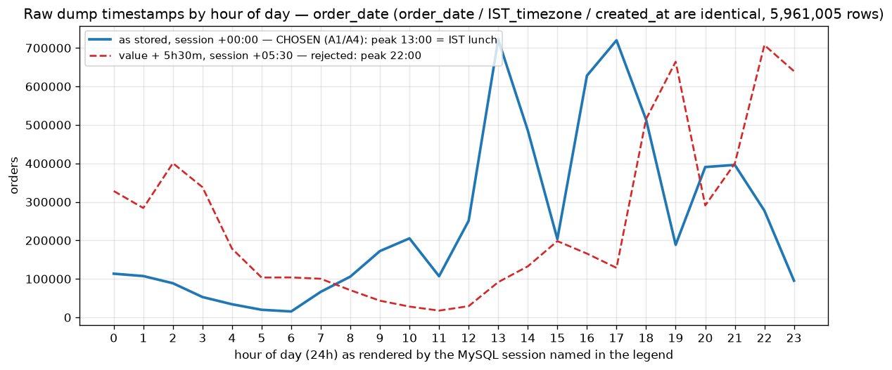

### 2.2 Cleaning rules (full log: `outputs/cleaning_log.csv`)

| Rule | Description | Before | Removed | After |
|---|---|---:|---:|---:|
| R0 | raw `orders` rows | 5,961,005 | 0 | 5,961,005 |
| R1 | dedupe on `id` (keep max `updated_at`) | 5,961,005 | **0** | 5,961,005 |
| R2 | valid `order_date` (non-null, ≥ 1971-01-02) | 5,961,005 | 0 | 5,961,005 |
| R3 | inside FY 2024-25 window | 5,961,005 | 17,115 | 5,943,890 |
| R4 | non-test branch (`NOT IN (6,7,8)`) | 5,943,890 | 0 | 5,943,890 |
| R5 | status rule (`paid` and not refunded) | 5,943,890 | 508,440 | 5,435,450 |
| R6 | `grand_total >= 0` | 5,435,450 | 0 | **5,435,450** |
| R0d | raw `order_details` rows | 7,426,133 | 0 | 7,426,133 |
| R1d | dedupe details on `id` | 7,426,133 | 0 | 7,426,133 |
| R7d | orphans (order_id not in raw orders) | 7,426,133 | 1,397 | 7,424,736 |
| R8d | details of orders outside clean scope | 7,424,736 | 638,060 | **6,786,676** |

Notes:
- The 17,115 R3 rows are all 2025-04-01 (out of FY); 14,839 of them (after the
  status/branch rules) are kept separately as `orders_holdout` for validation.
- **0 duplicate ids** were found (R1 removed nothing) — but 402,806 distinct
  `order_number`s over 5.96 M rows show daily numbering sequences are reused
  across branches/days; order numbers are therefore never used as keys (A8).
- Test branches 6/7/8 have zero orders anyway; the predicate is kept so the
  exclusion is explicit and logged (A7). Branch `-1` (1 row) and 11 (8 rows)
  are removed by R5 (all unpaid).
- `orders` (6.1 GB) and `order_details` (1.3 GB) were dropped after
  verification; `split/*.sql` remains the source of truth (A9).

---

## 3. EDA (all branches unless noted)

### 3.1 Branch portfolio (FY 2024-25, paid orders)

| id | Branch | Orders | Revenue (₹) | AOV | Active days | Months |
|---:|---|---:|---:|---:|---:|---:|
| 2 | Embassy Tech Village | 2,244,973 | 14,85,27,178 | 66.16 | 365 | 12 |
| 1 | Nirlon Knowledge Park | 2,121,046 | 15,30,27,900 | 72.15 | 365 | 12 |
| 9 | Magma | 595,405 | 3,96,48,776 | 66.59 | 198 | 7 |
| 4 | Magnus Tower | 443,194 | 2,56,36,802 | 57.85 | 364 | 12 |
| 10 | JPMT-Kalina | 30,455 | 17,49,113 | 57.43 | 61 | 4 |
| 3 | KANISHKA CAFE | 377 | 33,359 | 88.49 | 44 | 11 |

Auto-pick for forecasting: **branch 2** — largest volume with 12/12 months
coverage (`outputs/forecast_branch.txt`). Branches 9/10 opened mid-year
(7 and 4 months) — raw totals are not comparable without the coverage column.

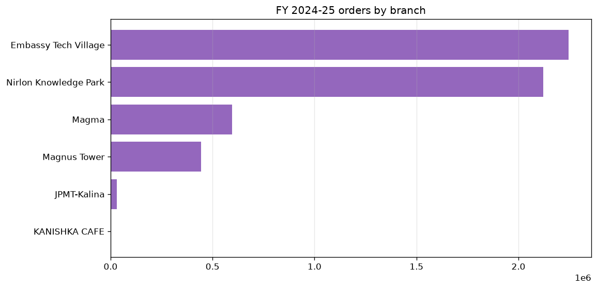

### 3.2 Trend & seasonality

- All-branch daily orders: mean **14,892**, min **571** (2024-10-06, a Sunday),
  max **29,681** (2025-01-22).
- Orders per day grow from **12,464** (2024-04) to a **18,193** peak (2025-02),
  i.e. **+46%** across the year; January 2025 is the largest month by total
  (548,777 orders), February the highest daily rate
   (`outputs/monthly_trend.csv`, charts
   `outputs/charts/monthly_orders_per_day.png`, `daily_orders_ma7.png`).

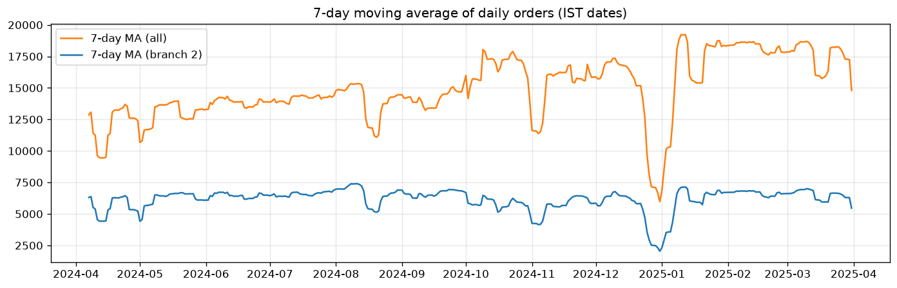

### 3.3 Weekly rhythm (branch 2)

| | Sun | Mon | Tue | Wed | Thu | Fri | Sat |
|---|---:|---:|---:|---:|---:|---:|---:|
| Orders | 10,448 | 439,516 | 475,937 | 469,304 | 443,123 | 371,992 | 34,653 |
| Avg/active day | **201** | 8,293 | **9,153** | 9,025 | 8,522 | 7,154 | **666** |

Sundays are near-closed (52 Sundays, ~200 orders/day) and Saturdays run at ~7%
of a weekday. Tuesday is the peak, Friday the softest working day
(`outputs/charts/dow_profile.png`).

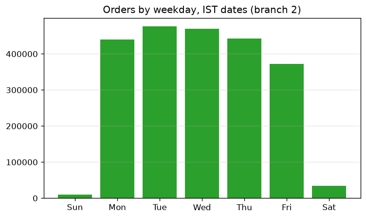

### 3.4 Daily shape (branch 2, hourly)

Peak hour **13:00** (266 k orders); the lunch block 12–14 h carries ≈25% of
volume, the evening block 16–18 h another ≈31%, and 20–22 h a supper tail.
Hours 00–04 still see ~300 orders/day combined — this outlet runs (partly)
24 h (`outputs/hourly_profile_branch.csv`, `outputs/charts/hourly_profile.png`).

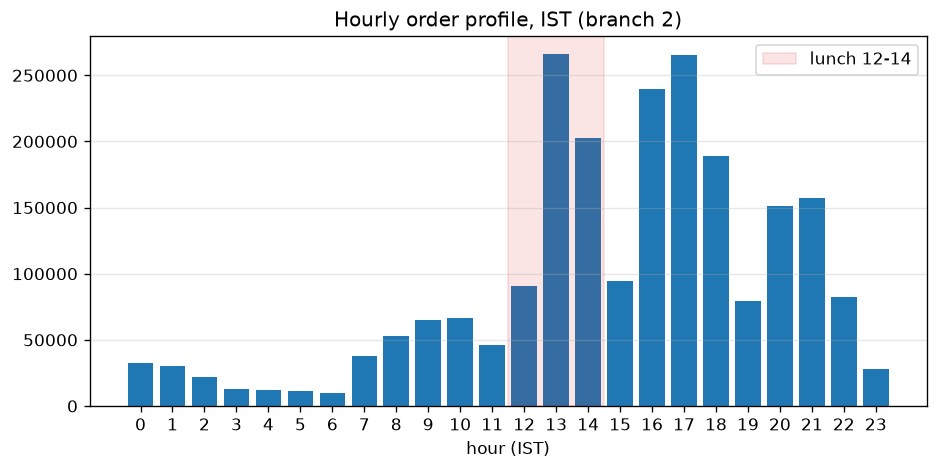

### 3.5 Products (branch 2)

- Volume is **tea-driven**: top 5 items are Ginger Tea (165 k), Reboot Chai
  (126 k), Regular Tea (115 k), Bombay Cutting Chai (108 k), Filter Kaapi
  (95 k) — 609 k units combined. On revenue the leaders are the Tandoor
  Non Veg Combo (₹41.6 lakh) and Tandoor Veg Combo (₹38.7 lakh); Veg Meal
  Combo is the biggest meal item by volume (63 k, ₹35.1 lakh).
  (`outputs/top_dishes_branch.csv`, `outputs/charts/top_dishes.png`)

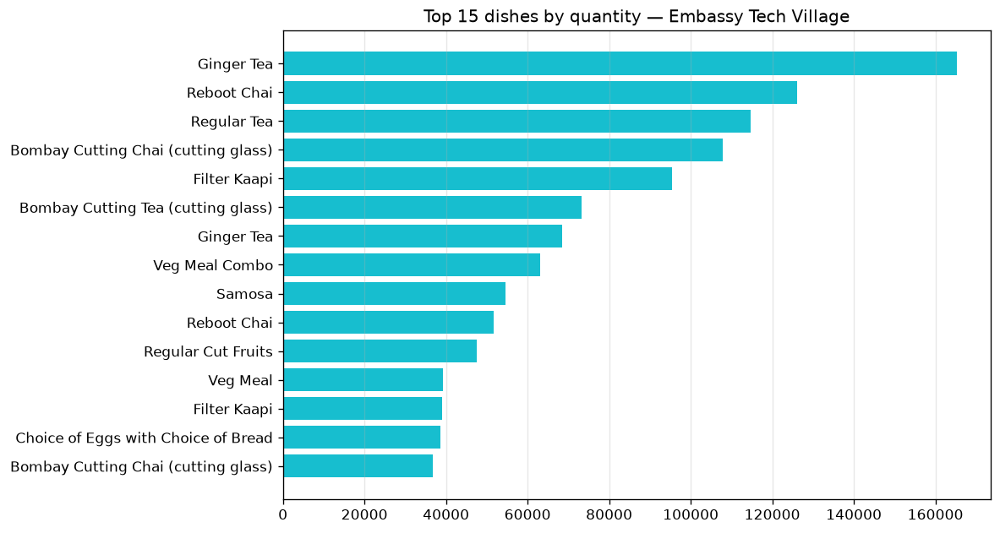
- Category mix (fractional attribution — see caveat): (no category) 665 k qty
  / ₹3.78 Cr, Tea/Coffee 570 k, Main Meal 314 k, TEST CATEGORY 175 k, Tea 169 k,
  Snack 164 k (`outputs/category_mix_branch.csv`).

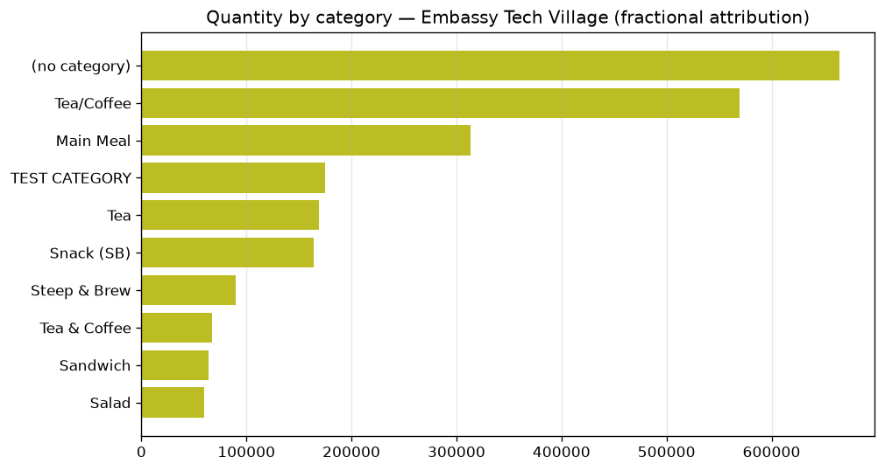
- **Data-quality flag:** 469 dishes are mapped to several categories (a plain
  join inflates quantity by 50%), every `dishes.category_id` is NULL, ~21% of
  quantity has no category at all, and a "TEST CATEGORY" carries real volume.

### 3.6 Channel & payment (branch 2)

- Channel: mobile app **84.6%** (1,898,820), self-order kiosk 13.1%, POS 2.3%.
- Payment: Paytm 71.1%, Razorpay 13.4%, UPI 11.9%, Card 3.5%; QR/cash appear
  only marginally here — the all-branch raw (pre-cleaning) dump shows Cash
  446 k and QR 387 k, which settle at the counters
  (`outputs/distributions.csv`). 1,359 orders have no payment mode recorded (0.06%).

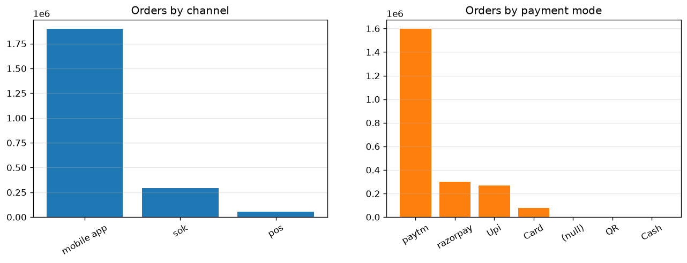

### 3.7 Customers (branch 2)

21,951 distinct users; **95.0% ordered more than once**, 87.7% at least five
times (all branches: 44,139 users, 95.1% repeat, 87.8% ≥5×). This is a captive,
habit-driven population — demand is highly regular, which the weekly seasonal
model exploits.

### 3.8 Footfalls cross-check (optional)

The independent `footfalls` table covers 297 days for branch 2 and reproduces
our cleaned daily counts almost exactly (corr = **1.00**; e.g. 2024-04-01:
7,978 covers vs 7,978 orders). This validates the timezone choice, the FY
window, and the status rule end-to-end without re-reading raw rows.

---

## 4. Forecast (branch 2, daily paid-order counts)

### 4.1 Setup

- Series: 365 FY days, 0 missing days, 2,244,973 orders.
- Models (no SARIMA/Prophet): **naive** (last value),
  **seasonal-naive** (same weekday last week), **Holt–Winters** (additive
  trend + weekly seasonality), **weekday OLS** (linear trend + weekday dummies).
- Evaluation: rolling-origin backtest, 10 folds × 7-day horizon (trains on
  295–358 days, tests the next week). Metrics pooled across folds.

### 4.2 Backtest results (`outputs/backtest_*.csv`)

| Model | Pooled wMAPE | Mean-fold wMAPE | Pooled MAE | Pooled RMSE | Mean sMAPE |
|---|---:|---:|---:|---:|---:|
| **seasonal-naive** | **0.102** | 0.105 | **668** | 1,423 | **0.123** |
| holt_winters | 0.117 | 0.119 | 761 | **1,188** | 0.287 |
| weekday_ols | 0.137 | 0.138 | 894 | 1,244 | 0.351 |
| naive | 0.498 | 0.503 | 3,248 | 4,698 | 0.626 |

**Pick: seasonal-naive** (lowest pooled wMAPE, 10.2%; `outputs/forecast_pick.txt`).
Holt–Winters edges it on RMSE (1,188 vs 1,423) but is worse on every
absolute/percentage metric and over-shoots on near-closed days (Sundays)
(mean sMAPE 0.29 vs 0.12) — a plain "last Tuesday = this Tuesday" rule is both
the baseline and the winner, which is the honest result for a strongly weekly,
effectively-Sunday-closed series. Naive is unusable (50% wMAPE) — level
changes weekday-to-weekday dominate.

### 4.3 7-day forecast, Apr 1–7 2025 (`outputs/forecast_7d.csv`)

| Date | Day | Forecast | 80% band | Actual (holdout) |
|---|---|---:|---:|---:|
| 2025-04-01 | Tue | 9,752 | 9,016 – 10,412 | **5,476*** |
| 2025-04-02 | Wed | 9,314 | 8,578 – 9,974 | |
| 2025-04-03 | Thu | 8,590 | 7,854 – 9,250 | |
| 2025-04-04 | Fri | 6,928 | 6,192 – 7,588 | |
| 2025-04-05 | Sat | 653 | 0 – 1,313 | |
| 2025-04-06 | Sun | 154 | 0 – 814 | |
| 2025-04-07 | Mon | 2,807 | 2,071 – 3,467 | |
| **Total** | | **38,198** | | |

\* The dump stops at **17:11:47 IST** on 2025-04-01 (branch 2's last order that
day is 17:11:27), so the actual is a **partial day outside FY** and cannot be
compared with a full-day forecast directly. Of all Tuesday volume in FY
2024-25 (475,937 orders), **280,317 (58.9%)** occurs at or before that cutoff
(`outputs/hourly_tuesday_branch.csv`), so the expected partial-day actual is
9,752 × 58.9% = **5,744**; observed **5,476** ⇒ **−4.7% (−268 orders)**, well
inside the backtest MAE of 668 orders/day. The training window ends
**2025-03-31** (`ist_date`), so the partial day never enters training or
backtest. Full numbers: `outputs/holdout_check.csv` (ASSUMPTIONS A12).

The band is the 10th–90th percentile of pooled backtest residuals
(−736 / +660 orders). Charts: `outputs/charts/forecast_full.png`,
`forecast_zoom.png`, `backtest_wmape.png`.

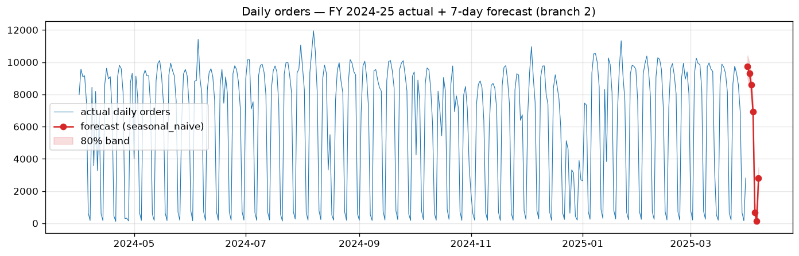

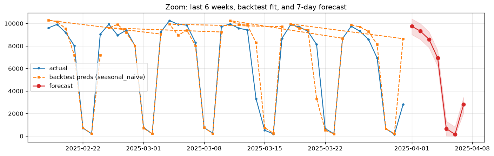

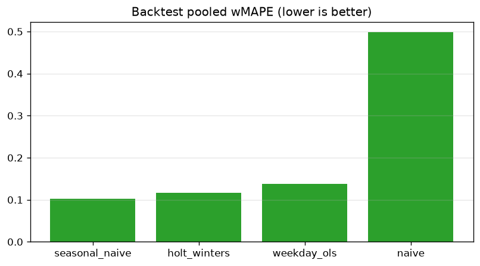

---

## 5. Insights

1. **Weekly shape, not trends, drives demand.** Same-weekday persistence
   carries a 10% wMAPE; a random walk does not (50%). Any planning tool that
   ignores the weekday cycle will be badly wrong on Sundays/Saturdays.
2. **The week has two regimes:** Mon–Thu ≈ 8.3–9.2 k orders/day (branch 2),
   Fri softer (7.2 k), Sat ~666, Sun ~201 (effectively closed).
3. **Lunch concentration:** 12–14 h carries ~25% of volume (24.9% branch 2,
   24.5% all branches); 16–18 h adds another evening block. Staffing fixed
   headcount across the day wastes ~40% of labour hours.
4. **Growth is real:** orders/day rose ~46% April→February; March 2025 still
   16,136/day vs 12,464 in April 2024.
5. **Tea is the franchise:** the top 5 SKUs are all tea/coffee (609 k units
   combined) — inventory and stock-outs here dominate the customer experience.
6. **Digital-first, Paytm-heavy:** 84.6% of branch-2 orders come through the
   mobile app and 71% settle via Paytm — single-provider concentration is a
   commercial risk and an untapped lever (fees, promos, QR underused in-app).
7. **Data quality limits categorisation:** 25% of revenue has no category,
   multi-mapping would have inflated category volumes by 50%, a TEST CATEGORY
   is live, 1,397 line items point to nonexistent orders, and payment/status
   history tables are missing from the dump — yet the independent footfalls
   table matches our cleaned counts at corr 1.00, so the core counts are sound.

## 6. Recommendations

1. **Roster & prep to the weekday curve:** full staffing Mon–Thu, reduced
   Fri, skeleton Sat, closed/skeleton Sun; shift the lunch peak by pre-cooking
   and offering 11:30–12:00 / 14:00–15:00 incentives to smooth the 12–14 h
   spike (capacity risk) and fill the 11 h / 15 h troughs.
2. **Use the seasonal-naive forecast operationally:** publish the 7-day
   forecast + ±700/day band daily; it beats fancier models here and costs
   nothing to run. Re-validate once a full April is available (current
   holdout is truncated).
3. **Protect the tea line:** top-5 SKUs are tea — manage them as A-items
   (safety stock, morning pre-brew, stock-out alerts); bundle tea with meal
   combos to lift the ₹66 AOV on the high-volume SKUs.
4. **Fix category data before any category-level pricing decision:**
   populate `dishes.category_id`, rebuild `category_has_dishes` without
   multi-mapping, delete TEST CATEGORY — today a quarter of ₹14.85 Cr revenue
   is unattributable.
5. **Harden the data model:** restore the missing tail of the dump
   (payments, status history), add PK/FK constraints (1,397 orphans would be
   impossible), validate `branch_id` (row with −1), and deprecate duplicate
   dish records (e.g. "Ginger Tea" under ids 200 and 3596).
6. **Payment mix:** negotiate with Paytm on volume (71% share) or steer users
   to UPI/QR with small incentives; monitor the 1,359 orders missing a payment
   mode.

## 7. Assumptions, limits & honesty notes

Full list: [ASSUMPTIONS.md](ASSUMPTIONS.md) (A1–A12). Most consequential:

- Timestamps are local wall clock (A1/A4) — all hour/day parts follow from it,
  cross-validated by the footfalls table.
- "An order" = paid, not refunded, in FY, at a non-test branch (A7/A12);
  `order_has_statuses` and all post-`order_has_statuses` tables are absent (A5).
- Category shares use fractional attribution for multi-mapped dishes (sums
  reconcile to the true 3,226,285 units within rounding).
- Forecast scope: one branch, daily counts, 4 models, 10 backtest
  folds; no external regressors (holidays/weather), no Prophet/ML.
- Holdout day is truncated at 17:11:47 IST and outside FY — compared only
  after scaling the forecast by the Tuesday share before that cutoff
  (58.9%): expected 5,744 vs actual 5,476, −4.7% (`outputs/holdout_check.csv`).
- Outputs contain aggregates only; PII and passwords never leave the DB shell.

## 8. Reproduce

```
set MYSQL_PWD=<password>   (never committed)
run_all.cmd                # stages 1–6 (see README.md for first-time import)
```
Key artifacts: `outputs/cleaning_log.csv`, `outputs/backtest_summary.csv`,
`outputs/forecast_7d.csv`, `outputs/holdout_check.csv`,
`outputs/charts/*.png` (10 EDA/tz + 3 forecast charts).
